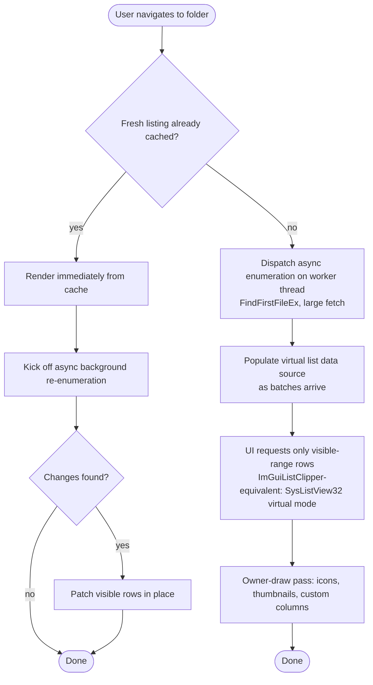

# Navigation flow — folder open (with cache short-circuit)

Note: the cache short-circuit is the primary lever against Explorer's "click and wait" feel — a previously visited folder must repaint before any disk I/O completes, with reconciliation happening invisibly afterward.

The list half of this flow, for a single directory, is `list_shell`. It paints `cached` before polling, appends batches on a miss, and replaces rows only when a revalidation finishes with a different listing. The tree in that binary follows the same cache-hit and batch rules for the child folders of a node the user expands. It does not change the list, and it does not draw the owner-draw pass.
